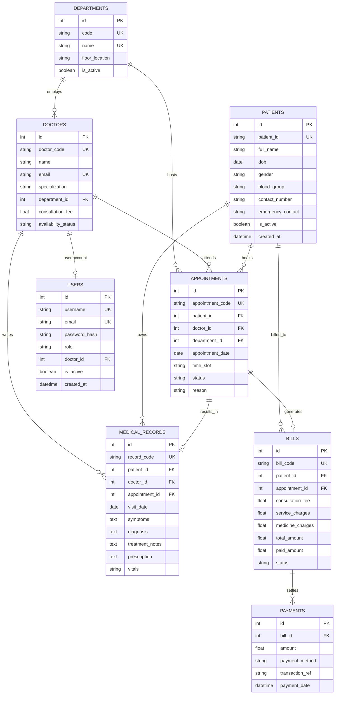

# MediCloud: Cloud-Based Hospital Management System (HMS)

> **College Final-Year Project Demonstration**  
> **Domain**: Cloud Computing, Enterprise Healthcare Information Systems, Full-Stack Web Engineering  
> **Status**: Complete & Production-Ready Prototype  

---

## 1. Abstract

**MediCloud** is a centralized, cloud-architected Hospital Management System (HMS) built to streamline clinical operations, outpatient appointment scheduling, medical practitioner management, patient electronic health records (EHR), and billing. The system incorporates Role-Based Access Control (RBAC) across Administrators, Receptionists, and Attending Doctors to enforce clinical data confidentiality, prevent doctor appointment schedule conflicts (double-booking), and generate printable financial invoices and real-time operational analytics.

---

## 2. Problem Statement

Traditional hospital environments frequently struggle with:
1. **Decentralized Record Keeping**: Fragmented physical paper charts or isolated desktop software prone to data loss, physical damage, and sluggish retrieval.
2. **Scheduling Conflicts**: Human booking errors that cause double-booking of doctors for overlapping consultation slots, leading to extended patient wait times and provider fatigue.
3. **Data Security & Privacy Vulnerabilities**: Uncontrolled access where administrative staff can view sensitive patient clinical diagnoses and physician notes without authorization.
4. **Billing Inaccuracies**: Inflexible or manual invoicing leading to calculation discrepancies, uncollected balances, and poor revenue cycle visibility.

---

## 3. Objectives

- **Centralized Cloud Platform**: Deliver a responsive, modern web application accessible across clinical desktops, nursing tablets, and administrative workstations.
- **Double-Booking Prevention**: Implement server-side transactional validation that eliminates scheduling overlaps for physicians.
- **Strict Role-Based Access Control (RBAC)**: Enforce least-privilege security between Administrators, Receptionists, and Doctors.
- **Clinical Records (EHR)**: Provide restricted clinical documentation for vital signs, symptoms, diagnoses, and medical prescriptions.
- **Automated Billing Engine**: Support itemized consultation, lab service, and pharmacy fee calculations with payment status tracking and printable invoices.
- **Real-Time Database Analytics**: Provide real-time KPI metrics and Chart.js visualizations driven by live database queries.

---

## 4. Existing System vs. Proposed System

| Dimension | Existing / Legacy Systems | MediCloud Proposed System |
| :--- | :--- | :--- |
| **Architecture** | Local desktop installations or paper files | Centralized Cloud Architecture (Python Flask + REST APIs) |
| **Data Consistency** | High likelihood of human scheduling conflict | Server-side validation preventing physician double-booking |
| **Security & Privacy** | Plain-text or unprotected access | Bcrypt-hashed credentials, CSRF protection, and route-level RBAC |
| **Clinical Records** | Scattered diagnostic slips and loose paper notes | Encrypted, restricted electronic medical records module |
| **Billing & Payments**| Disconnected counter calculations | Integrated invoice generation, payment history, and printable receipts |
| **Analytics** | Manual end-of-month register reconciliation | Live interactive dashboard powered by database aggregations & Chart.js |

---

## 5. System Architecture

MediCloud follows a 3-Tier Layered Architecture designed for local development in SQLite and cloud deployment with PostgreSQL / Cloud SQL:

```mermaid
graph TD
    Client["Client Web Browsers (Desktop / Tablet / Mobile)"]
    
    subgraph Presentation_Layer [Presentation Layer]
        HTML5["HTML5 & Semantic Structure"]
        CSS["Bootstrap 5 + Custom Healthcare Theme (CSS3)"]
        JS["Vanilla JS & Chart.js Analytics Engine"]
    end

    subgraph Application_Layer [Application Layer (Flask Engine)]
        AuthBP["Auth Blueprint & RBAC Security"]
        DashBP["Dashboard & Analytics Blueprint"]
        PatientBP["Patient Management Blueprint"]
        DoctorBP["Doctor Management Blueprint"]
        AptBP["Appointment Lifecycle Blueprint"]
        MedBP["Medical Records EHR Blueprint"]
        BillBP["Billing & Revenue Blueprint"]
        RestAPI["REST API Endpoints (/api/*)"]
    end

    subgraph Service_Layer [Business Logic & Service Layer]
        PatServ["PatientService (ID Generation, Search, Filter)"]
        AptServ["AppointmentService (Conflict Detection, Slot Logic)"]
        BillServ["BillingService (Itemization, Payment Ledger)"]
    end

    subgraph Data_Layer [Data & Persistence Layer]
        SQLA["SQLAlchemy 2.0 ORM Engine"]
        DB[("SQLite3 (Dev) / PostgreSQL (Cloud Prod)")]
    end

    Client --> Presentation_Layer
    Presentation_Layer --> Application_Layer
    Application_Layer --> Service_Layer
    Service_Layer --> Data_Layer
```

---

## 6. Functional Modules

### 6.1 Authentication & Role-Based Access Control (RBAC)
- **Administrator**: Complete control over doctors, departments, system settings, patients, appointments, billing, and reports.
- **Receptionist**: Patient demographic registration, appointment booking, rescheduling, and billing collection.
- **Doctor**: Personalized consultation queue, patient clinical history review, and medical encounter documentation.
- **Security Features**: Werkzeug password hashing, session cookies with `HttpOnly` and `SameSite` flags, and CSRF token protection.

### 6.2 Patient Management
- Auto-generates sequential, unique patient identifiers (e.g., `PAT-2026-0001`).
- Captures demographics, emergency contacts, blood group, and medical history.
- Dynamic filtering by registration date range, name, ID, and active status.
- Soft deactivation (safe toggle rather than destructive deletion).
- Sanitized CSV export for administrative audits (excluding private clinical notes).

### 6.3 Doctor & Department Management
- Physicians associated with specific clinical departments (Cardiology, Neurology, Pediatrics, Orthopedics, General Medicine).
- Real-time physician availability status toggles: `Available`, `Busy`, `On Leave`.
- Consultation fee definitions and doctor-specific appointment schedule viewer.

### 6.4 Appointment Scheduling & Conflict Prevention
- Date and time slot booking across standard outpatient intervals.
- **Zero Double-Booking Guarantee**: Server-side transactional validation blocks conflicting active bookings (`Scheduled` / `Confirmed`) for the same doctor.
- Lifecycle actions: `Scheduled` &rarr; `Confirmed` &rarr; `Completed` or `Cancelled`.
- Rescheduling with conflict detection against other bookings.

### 6.5 Restricted Medical Records (EHR)
- Restricted strictly to authorized Doctors and Administrators.
- Records vital signs (BP, Pulse, SpO2, Temperature, Weight), symptoms, diagnoses, treatment notes, and pharmaceutical prescriptions.
- Previous visit history timeline for longitudinal clinical tracking.
- Clinical documentation disclaimer emphasizing medical staff responsibility.

### 6.6 Billing & Payment Management
- Automated invoice calculation: `Subtotal = Consultation + Services + Medicines`, followed by flat discounts and tax percentages.
- Payment status lifecycle: `Unpaid`, `Partially Paid`, and `Paid`.
- Payment transaction ledger tracking payment mode (Cash, Credit Card, UPI, Insurance, Bank Wire).
- Clean, printable official invoice layout with hospital letterhead and signature blocks.

---

## 7. Technology Stack

- **Frontend**: HTML5, CSS3, JavaScript (ES6+), Bootstrap 5.3, Bootstrap Icons, Chart.js 4.4.
- **Backend**: Python 3.12, Flask 3.0.
- **Database & ORM**: SQLAlchemy 2.0 with Flask-SQLAlchemy 3.1 (SQLite local, PostgreSQL for cloud).
- **Authentication**: Flask-Login 0.6 & Werkzeug Security.
- **Form Security**: Flask-WTF 1.2 & WTForms.
- **Testing**: pytest 8.3 & pytest-flask.
- **WSGI / Cloud Server**: Gunicorn 23.0.

---

## 8. Database Schema



---

## 9. Installation & Local Setup

### Prerequisites
- Python 3.10+ (Developed and validated on Python 3.12)
- Git

### Step-by-Step Setup
1. **Clone or Open the Repository**:
   ```bash
   cd "hospital management"
   ```

2. **Create and Activate a Virtual Environment**:
   - **Windows (PowerShell)**:
     ```powershell
     python -m venv venv
     .\venv\Scripts\Activate.ps1
     ```
   - **Linux / macOS**:
     ```bash
     python3 -m venv venv
     source venv/bin/activate
     ```

3. **Install Dependencies**:
   ```bash
   pip install -r requirements.txt
   ```

4. **Configure Environment Variables**:
   Copy `.env.example` to `.env`:
   ```bash
   cp .env.example .env
   ```

5. **Initialize Database & Seed Synthetic Demo Data**:
   ```bash
   python seed.py
   ```

---

## 10. Execution Commands

### Running Locally with Flask Development Server
```bash
python app.py
```
Open your browser and navigate to:  
**`http://127.0.0.1:5000`**

### Running with Production WSGI Server (Gunicorn)
```bash
gunicorn --bind 0.0.0.0:5000 app:app
```

---

## 11. Pre-Configured Demo Credentials

For quick evaluation, use the one-click credential buttons on the login screen:

| Role | Username | Password | Access Rights |
| :--- | :--- | :--- | :--- |
| **Administrator** | `admin` | `Admin@123` | Full administrative, medical, and billing control |
| **Receptionist** | `reception` | `Reception@123` | Patient registration, scheduling, billing collection |
| **Doctor (Cardiology)** | `dr.smith` | `Doctor@123` | Assigned schedule, clinical medical charts & prescriptions |
| **Doctor (Neurology)** | `dr.chen` | `Doctor@123` | Assigned schedule, clinical medical charts & prescriptions |

---

## 12. Automated Testing

MediCloud includes an automated `pytest` test suite covering authentication, RBAC authorization, patient registration, double-booking prevention, billing calculations, and REST APIs.

### Run All Tests:
```bash
pytest -v
```

### Run Specific Test Modules:
```bash
pytest tests/test_appointments.py -v   # Validates double-booking prevention & scheduling
pytest tests/test_auth.py -v           # Validates RBAC security & logins
pytest tests/test_billing.py -v        # Validates invoice calculations & payment ledgers
pytest tests/test_patients.py -v       # Validates registration & duplicate ID prevention
pytest tests/test_api.py -v            # Validates JSON REST endpoints
```

---

## 13. REST API Documentation

All API endpoints are prefixed with `/api` and return standardized JSON responses.

### 13.1 Dashboard Metrics
- **Endpoint**: `GET /api/dashboard/stats`
- **Response**:
  ```json
  {
    "success": true,
    "data": {
      "total_patients": 24,
      "total_doctors": 6,
      "today_appointments": 5,
      "completed_appointments": 8,
      "pending_appointments": 14,
      "cancelled_appointments": 3,
      "monthly_trend": [0, 0, 0, 0, 0, 0, 0, 0, 0, 25, 0, 0]
    }
  }
  ```

### 13.2 Patient API
- **List Patients**: `GET /api/patients?q={search}&status={active|inactive}`
- **Create Patient**: `POST /api/patients`
  ```json
  {
    "full_name": "Eleanor Vance",
    "dob": "1990-11-23",
    "gender": "Female",
    "contact_number": "+1-555-0202",
    "email": "eleanor.v@example.com"
  }
  ```

### 13.3 Appointment API
- **Filter Appointments**: `GET /api/appointments?date={YYYY-MM-DD}&doctor_id={id}&status={status}`
- **Book Appointment**: `POST /api/appointments`
  ```json
  {
    "patient_id": 1,
    "doctor_id": 1,
    "appointment_date": "2026-10-25",
    "time_slot": "09:00 - 09:30",
    "reason": "Cardiovascular consultation"
  }
  ```
- **Update / Reschedule**: `PATCH /api/appointments/{id}`
  ```json
  {
    "status": "Confirmed"
  }
  ```

### 13.4 Billing API
- **List Invoices & Financial Summary**: `GET /api/billing?status={status}`
- **Create Invoice**: `POST /api/billing`

---

## 14. Cloud Deployment Instructions

MediCloud is designed for 12-factor cloud deployment on platforms like Render, Railway, PythonAnywhere, or AWS/GCP.

### 14.1 Deploying to Render.com (Recommended Free/Low-Cost Cloud)
1. Fork or push this repository to your GitHub account.
2. Sign in to [Render.com](https://render.com) and click **New + &rarr; Web Service**.
3. Connect your GitHub repository.
4. Set the following configuration:
   - **Environment**: `Python 3`
   - **Build Command**: `pip install -r requirements.txt`
   - **Start Command**: `gunicorn app:app`
5. Under **Environment Variables**, add:
   - `FLASK_ENV`: `production`
   - `SECRET_KEY`: *(Generate a secure random string)*
   - `SESSION_COOKIE_SECURE`: `True`
   - `DATABASE_URL`: *(Connect a Render PostgreSQL database instance or use persistent disk SQLite)*
6. Click **Deploy Web Service**. Render will automatically provision the container and issue a free SSL certificate.

### 14.2 Database Recommendations for Multi-User Production
- **Local Prototype**: SQLite3 (`sqlite:///instance/medicloud.db`) is ideal for zero-configuration demonstrations.
- **Production Multi-User**: Use a managed relational database such as PostgreSQL (via AWS RDS, Google Cloud SQL, or Render Managed PostgreSQL) to support concurrent writes, ACID transactions, automated point-in-time backups, and horizontal scaling.

---

## 15. GitHub Version Control & Repository Setup

To push your MediCloud project to GitHub:

```bash
# 1. Initialize Git repository
git init

# 2. Add files while honoring .gitignore (ignoring venv, .env, and local databases)
git add .

# 3. Commit the project
git commit -m "Initial commit: MediCloud HMS college final-year project"

# 4. Set default branch to main
git branch -M main

# 5. Link your remote GitHub repository
git remote add origin https://github.com/<your-username>/medicloud-hms.git

# 6. Push to GitHub
git push -u origin main
```

---

## 16. Academic Demonstration Disclaimer & Limitations

- **Academic Context**: This application was designed as a college final-year engineering demonstration. All patient names, telephone numbers, and clinical histories in the seed dataset are entirely synthetic.
- **Regulatory Status**: MediCloud is a prototype demonstration and is not certified for real clinical use under HIPAA, GDPR-Health, or ISO 27799.
- **Limitations**: Automated clinical diagnostic decisions are intentionally omitted to comply with medical documentation safety standards.

---

## 17. Future Enhancements

1. **Telemedicine Video Integration**: WebRTC-based encrypted video consultations between physicians and home patients.
2. **DICOM Medical Imaging**: Cloud PACS viewer for DICOM radiological scans (X-ray, CT, MRI).
3. **SMS / Email Notifications**: Automated reminder triggers via Twilio or SendGrid 24 hours prior to appointment slots.
4. **HL7 / FHIR Interoperability**: Support for Fast Healthcare Interoperability Resources (FHIR) standard data interchange with external laboratory equipment.
